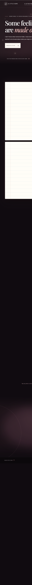
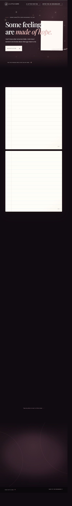
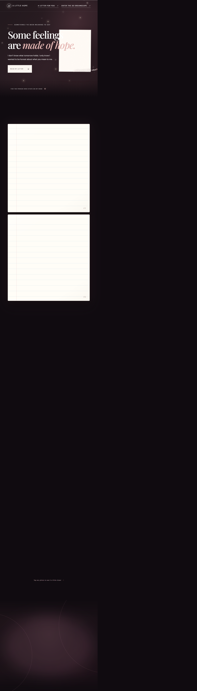
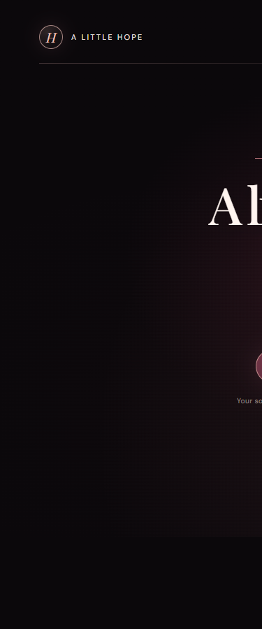
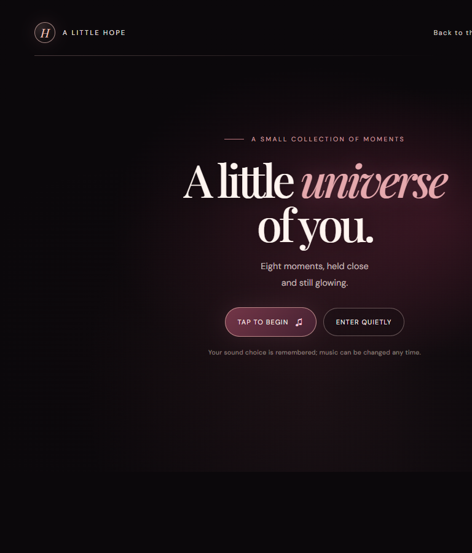
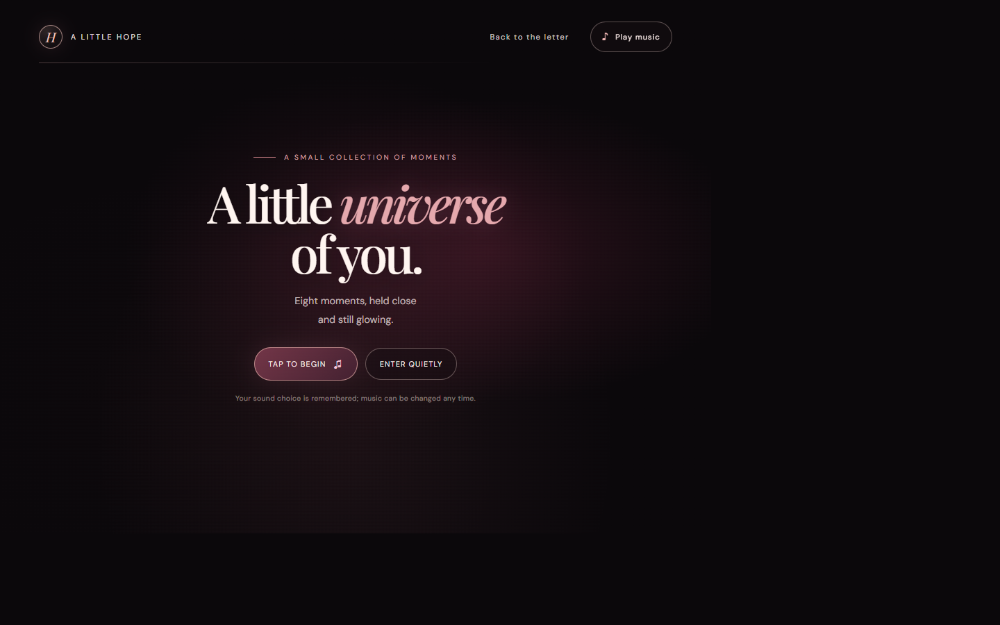

# Preview evidence

All screenshots below were captured locally in Chrome at the listed CSS viewport sizes. Personal photo pixels are deliberately hidden in every image; no original or derived personal photo is included in these previews. Full unredacted visual QA screenshots remain local only.

## Before / after

### Letter page — 375 px

 

### Letter page — 1440 px

 

### 3D gallery — 375 px

 

### 3D gallery — 1440 px

 

## Next-level responsive captures

These local production-preview screenshots were refreshed after the responsive-image and mobile-motion changes. Personal photo pixels and the 3D canvas were hidden at capture time; the original photos were not sent to any external service.

### Letter

### A Little Universe of You

## Lighthouse mobile (local production preview)

Latest Lighthouse mobile runs against the local production preview, using simulated throttling:

| Page | Performance | Accessibility | Best Practices | LCP | CLS | TBT |
| --- | ---: | ---: | ---: | ---: | ---: | ---: |
| Letter | 92 | 100 | 100 | 2.9 s | 0 | 70 ms |
| A Little Universe of You | 95 | 100 | 96 | 2.6 s | 0.001 | 70 ms |

Both pages meet the requested 85+ Performance, 95+ Accessibility, and 95+ Best Practices thresholds. These are Lighthouse lab results, not field Core Web Vitals; LCP remains slightly above the 2.5 s field target in these simulated runs.

## Responsive and browser checks

Production preview checked at 320, 375, 390, 768 and 1440 px on both routes:

- No horizontal overflow or browser console/page errors.
- No external network requests; local fonts load, and `noindex, nofollow` remains on both pages.
- 3D canvas and scene chunk are absent until the user enters; mobile swipe advances the selected memory.
- The gallery resizes source textures locally in a browser canvas and adapts renderer pixel ratio based on observed frame rate.
- The sound preference persists across reloads; the offline worker caches same-origin pages and serves a text-only fallback when navigation is unavailable.
- Photos use locally generated responsive WebP variants; the original JPEGs remain unchanged and no photo is sent to a third party.

## Things to fill in when ready

- Optional date and one-line note for each of the eight memories in `src/memories.js`.
- Preferred music direction if you want the synthesized Web Audio ambience changed.
- Optional social preview artwork if you want a different photo-free image; current Open Graph preview avoids personal images.